  

Делаю сайты и Telegram-ботов для малого бизнеса: быстро и недорого. Два года работал в «Додо Пицце», дорос от стажёра до заместителя управляющего, поэтому понимаю, что нужно бизнесу.

### Что я сделал

- **[JARVIS OS](https://github.com/SelfRenewer/jarvis-os)**: личный ИИ-ассистент. Чат и голос на русском, Todoist, Google Calendar, Telegram, приложение для Mac.
- **[SiteDock](https://github.com/SelfRenewer/sitedock)**: менеджер локальных сайтов в строке меню macOS. Live reload, ссылки с QR, туннели.
- **[Стопка](https://github.com/SelfRenewer/stopka-youtube)**: расширение для Chrome, Edge и Safari. Кнопка на превью YouTube сохраняет видео в список.
- **Сайт стоматологии (концепт)**: 87 страниц на 3 языках, заявки в CRM и Telegram.
- **Онлайн-запись для салона**: через Telegram-бота.

### Как я работаю

Делаю, показываю, вы платите по готовности. Предоплату не беру.

### Стек

